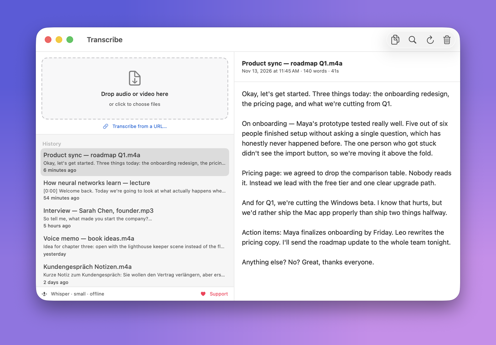
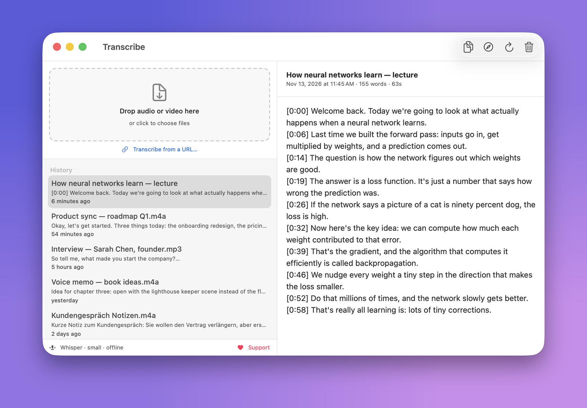

# Transcribe

A self-contained macOS app that transcribes audio and video files **locally** on your Mac. No cloud upload, nothing to install. Drop a file in, get text out. Optionally paste a YouTube URL for a timestamped transcript.

Built with SwiftUI and [whisper.cpp](https://github.com/ggerganov/whisper.cpp) (CoreML + Metal accelerated), bundled inside the `.app`.

**[⬇ Download for macOS](https://github.com/J3012B/Transcribe_Mac/releases/latest/download/Transcribe.dmg)** · [Website](https://transcribe.heliconsolutions.net/) · [♥ Donate](https://donate.stripe.com/14AdR8fWj0ts8CUeoGd3i00)



## Support

Transcribe is free and open source, with no ads, accounts or tracking. If it saves
you time, consider **[making a small donation](https://donate.stripe.com/14AdR8fWj0ts8CUeoGd3i00)**. It helps keep
the app maintained. Thank you!

## Features

- 100% offline transcription (audio never leaves the machine)
- Bundles whisper.cpp with CoreML + Metal acceleration
- Converts audio via AVFoundation (no ffmpeg required)
- Downloads the Whisper model automatically on first launch (~650MB, cached)
- Supports `m4a, mp3, wav, aiff, caf, flac, mp4, mov, m4v, aac, 3gp, amr, au, ogg, oga, opus, webm`
- Optionally paste a YouTube (or other video) URL to transcribe it **with timestamps** — the required tools are fetched on demand, not bundled

### Transcribing from a URL (secondary feature)



Click **"Transcribe from a URL…"** under the drop zone, paste a YouTube (or other
video) link, and the app downloads just the audio and produces a timestamped
transcript (`[m:ss] …` lines). This is the one feature that reaches the network —
it fetches the video you asked for; the transcription itself still runs locally.

To keep the app small (~5 MB), the helper tools this needs are **downloaded on
demand the first time you use the feature** — not bundled:

- [`yt-dlp`](https://github.com/yt-dlp/yt-dlp) — downloads the audio stream
- [`deno`](https://deno.com) — the JavaScript runtime recent yt-dlp needs for YouTube
- [`ffmpeg`](https://ffmpeg.org) — decodes Opus/WebM streams when needed

They land in `~/Library/Application Support/Transcribe/tools/` (about 110 MB, one
time). If a copy is already installed on the system (e.g. via Homebrew), it's used
and that download is skipped. People who never touch this feature never pay for it.

> **Note:** Downloading content from YouTube may be against its Terms of Service.
> Use this only for videos you own or have permission to download.

### A note on Ogg / Opus / WebM

Most formats are decoded natively via AVFoundation. Ogg Vorbis, Opus and WebM
can't be decoded by macOS Core Audio, so those files are transcoded with the
bundled `ffmpeg`.

## Requirements

- macOS 14.0 or later
- Apple Silicon (arm64)
- Xcode command line tools (`xcode-select --install`) for building

## Build

```bash
./build.sh
```

This compiles `TranscribeApp.swift` and assembles `build/Transcribe.app` (~5 MB).
To install:

```bash
cp -R build/Transcribe.app /Applications/
lsregister -f /Applications/Transcribe.app
```

## Shipping

**Push to `main` ships a release.** `.github/workflows/release.yml` builds on an
Apple-Silicon runner, packages a DMG, and publishes a GitHub Release. Every
release includes a stable-named **`Transcribe.dmg`**, so these three channels
always point at the newest build with no extra work:

- **GitHub** — <https://github.com/J3012B/Transcribe_Mac/releases/latest>
- **Website** — the page in `docs/` (GitHub Pages) links to
  `releases/latest/download/Transcribe.dmg`
- **Install script** — `install.sh`:
  ```bash
  curl -fsSL https://raw.githubusercontent.com/J3012B/Transcribe_Mac/main/install.sh | bash
  ```

Versioning is automatic: the tag is `v<marketing>.<run-number>` (e.g. `v1.0.42`),
where the marketing part comes from `Info.plist`. Bump it when you want a new
minor/major:

```bash
scripts/bump-version.sh 1.1      # edits Info.plist -> next builds are 1.1.<run>
git commit -am "Release 1.1" && git push
```

Pull requests and non-`main` branches get a build check via
`.github/workflows/ci.yml` (no release).

### Signing & notarization (for a warning-free download)

Without an Apple **Developer ID** the DMG is **ad-hoc** — the website download
shows a Gatekeeper prompt (right-click ▸ Open), though the `install.sh` path works
because it strips quarantine. For a clean public download, add these repo secrets
and every `main` push is signed + notarized automatically:

| Secret | What |
|---|---|
| `MACOS_CERT_P12` | base64 of your "Developer ID Application" `.p12` |
| `MACOS_CERT_PASSWORD` | password for that `.p12` |
| `MACOS_SIGN_IDENTITY` | `Developer ID Application: Your Name (TEAMID)` |
| `AC_APPLE_ID` / `AC_PASSWORD` / `AC_TEAM_ID` | Apple ID + app-specific password + team id (notarization) |

Build a signed DMG locally the same way:

```bash
export SIGN_IDENTITY="Developer ID Application: Your Name (TEAMID)"
export NOTARY_PROFILE="transcribe"   # from `xcrun notarytool store-credentials`
./build.sh && ./scripts/make-dmg.sh
```

### One-time setup on GitHub

Enable Pages so the website goes live: **Settings ▸ Pages ▸ Source: Deploy from a
branch ▸ `main` / `docs`**. The site then updates on every push.

## Project layout

| Path | Purpose |
|---|---|
| `TranscribeApp.swift` | The entire app (SwiftUI, single file) |
| `build.sh` | Compiles + assembles + signs the `.app` bundle |
| `Info.plist` | App bundle metadata (`net.heliconsolutions.transcribe`) |
| `Resources/` | App icon (`.icns`), mic glyphs, icon master |
| `vendor/whisper/` | Bundled whisper.cpp runtime (`whisper-cli` + dylibs) |
| `icon/` | Python scripts that regenerate the icon and glyph assets |
| `install.sh` | `curl \| bash` installer (downloads the latest release DMG) |
| `docs/` | GitHub Pages landing page |
| `scripts/make-dmg.sh` | Packages (and optionally signs/notarizes) the DMG |
| `scripts/bump-version.sh` | Bumps the marketing version in `Info.plist` |
| `.github/workflows/ci.yml` | Build check on PRs / non-main branches |
| `.github/workflows/release.yml` | Push-to-main build → DMG → GitHub Release |
| `scripts/` | CLI helpers — `transcribe.sh` (headless whisper wrapper), notify + AppleScript |

The `yt-dlp` / `deno` / `ffmpeg` helpers are **not** in the repo or the bundle —
`ToolsManager` in `TranscribeApp.swift` downloads them on demand (pinned versions)
into `~/Library/Application Support/Transcribe/tools/`.

## CLI usage

For scripted / headless transcription without the GUI:

```bash
scripts/transcribe.sh <file-path> [language] [--copy]
```
